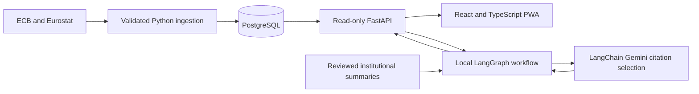

# MacroPulse AI

MacroPulse AI is an evidence-based research workspace for the euro area. Its installable web app charts official ECB and Eurostat observations and, in an enabled local workspace, answers macroeconomic questions with reproducible calculations and linked institutional context.

## Explore the workspace

| Indicator | Source | Frequency and unit |
| --- | --- | --- |
| EUR/USD reference rate | ECB | Daily, US dollars per euro |
| Real GDP growth | Eurostat | Quarterly, percent change from the previous quarter |
| Headline HICP inflation | Eurostat | Monthly, percent change from the same month a year earlier |
| M3 money stock | ECB | Monthly, millions of euros |
| ECB deposit facility rate | ECB | Effective-date events, percent per year |

Select an indicator and dates, then inspect the chart and its observation table. The workspace shows source links, series keys, units, geography, status and capture time when available. Missing observations stay visible in the table as gaps. The deposit rate chart shows applicability only where continuous coverage was verified. The original asset explorer is available under **Market archive**.

## Architecture



FastAPI and psycopg serve bounded historical reads. PostgreSQL stores observations and ingestion provenance. React, TypeScript and Vite deliver the charts and PWA shell. A Cloudflare Worker and a separate Render origin configuration provide the public demo boundary.

For the default local AI research flow, LangGraph routes a supported question to read-only statistical tools, retrieves source material, checks sufficiency and answers or abstains. The RAG index ranks eight reviewed ECB and Eurostat summaries with topic filtering, TF-IDF term vectors and cosine similarity. It filters out documents published after the selected end date. LangChain requests a structured selection of evidence IDs from Gemini. The server validates those IDs and assembles the response from deterministic statistics and attributed summaries. The original question stays local in this flow.

[Experimental Research v2](docs/m7d/research-v2.md) is available in the loopback PWA with explicit activation. It sends the original question to Gemini for structured interpretation and uses the approved M7.B corpus for documentary context.

## Local development

On Windows 11, double-click **MacroPulse AI.bat**. It opens MacroPulse AI in the default browser at `http://127.0.0.1:5173/` and shows the iPhone Safari URL on the page. Connect the iPhone and PC to the same trusted network and use the **Private** network profile on the PC. The launcher detects the PC's address each time the services start.

1. Run **Install MacroPulse AI.bat** once to add **MacroPulse AI** to Start. Find it in Start search and choose **Pin to taskbar** if that option is available. The shortcut uses the Windows command processor and the MacroPulse icon. [Windows taskbar instructions](https://support.microsoft.com/en-us/windows/experience/personalization/customize-the-taskbar-in-windows)
2. If Windows Firewall blocks Safari on the private network, run **Enable MacroPulse AI LAN.bat** once and approve the Windows elevation prompt. It adds an inbound rule for Node on TCP 5173, the selected interface, the Private profile and local subnet. Run setup again if you switch adapters or change the Node installation path. Daily launches run with ordinary user permissions.
3. Click **MacroPulse AI** again to reopen the page using the running services. Use **Stop MacroPulse AI.bat** to stop them. Restart the launcher after changing the network or editing frontend source so it can rebuild the local frontend.

The launcher uses the existing DEV read-only settings and Gemini key from the backend environment or ignored root `.env`. FastAPI listens on `127.0.0.1:8000`, and both frontend listeners serve the same compiled app. The LAN proxy accepts only peers on the selected private subnet and allows up to 60 history requests and three research submissions per rolling minute across the LAN listener. LAN access uses HTTP, so use it only on a trusted private network.

If setup is missing, install Python 3.12 and a Node release supported by [frontend/package.json](frontend/package.json), then install the repository dependencies once from PowerShell at the repository root:

```powershell
py -3.12 -m venv .venv
.\.venv\Scripts\python.exe -m pip install -r backend/requirements-ai.txt -r backend/requirements-dev.txt
Set-Location frontend
npm.cmd ci
```

The launcher reports startup errors in its window. The latest supervisor status is in `status.txt` under `%LOCALAPPDATA%\MacroPulse AI\` in the checkout's subdirectory. For hot reload and manual development, see the [frontend guide](frontend/README.md).

## Run the tests locally

From the repository root, with test DSNs unset:

```powershell
.\.venv\Scripts\python.exe -m pytest -ra
```

For database integration tests, follow the [disposable PostgreSQL workflow](docs/market-data-postgres.md#local-tests) and set `MACRO_DATA_TEST_DSN` to the same disposable loopback instance as `MARKET_DATA_TEST_DSN`. From `frontend`, run:

```powershell
npm.cmd test
npm.cmd run test:worker
npm.cmd run lint
npm.cmd run build
npm.cmd run build:public
```

## Security and deployment

The public demo serves five official macro indicators from an isolated read-only DEMO projection. Research v2 is opt-in and requires Turnstile, a global SQLite reservation and the authenticated Render origin. The PWA caches its shell and excludes API responses. See the [deployment runbook](docs/public-deployment-runbook.md) for activation and rollback.

The repository contains the public build, Worker and Render configuration and a DEMO projection. Public macro deployment still requires an authorized, isolated Supabase DEMO load, verified attribution and role grants, and end-to-end checks of the deployed Worker and Render origin. Research activation requires the authorized Turnstile and Gemini configuration and the deployed acceptance checks.

## Research limitations

The corpus and supported intent vocabulary are deliberately small. Charts and calculations use the captured series revisions available locally. The selected date window and document publication cutoff do not reconstruct the exact information available at a historical date. Correlations describe the sample and do not establish causality. The app provides historical research rather than forecasts or investment recommendations.

- [Official series contracts](docs/macro/official-series-contracts.md)
- [Source attribution and reuse policy](docs/macro/data-reuse-policy.md)
- [Migration history and architecture decisions](docs/macro/migration-progress.md)
- [M6 review and verification record](docs/macro/m6-progress.md)
- [Market archive and PWA development guide](frontend/README.md)
