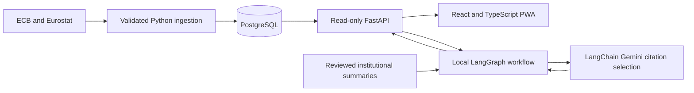

# MacroPulse AI

MacroPulse AI is an evidence-based research workspace for the euro area. Its installable web app charts official ECB and Eurostat observations and, in an enabled local workspace, answers macroeconomic questions with reproducible calculations and linked institutional context.

## Explore the workspace

| Indicator | Source | Frequency and unit |
| --- | --- | --- |
| EUR/USD reference rate | ECB | Daily, US dollars per euro |
| Real GDP growth | Eurostat | Quarterly, percent change from the previous quarter |
| Headline HICP inflation | Eurostat | Monthly, percent change from the same month a year earlier |
| M3 money stock | ECB | Monthly, millions of euros |
| ECB deposit facility rate | ECB | Effective-date events, percent per year |

Select an indicator and dates, then inspect the chart and its observation table. The workspace shows source links, series keys, units, geography, status and capture time when available. Missing observations stay visible in the table as gaps. The deposit rate chart shows applicability only where continuous coverage was verified. The original asset explorer is available under **Market archive**.

## Architecture



FastAPI and psycopg serve bounded historical reads. PostgreSQL stores observations and ingestion provenance. React, TypeScript and Vite deliver the charts and PWA shell. A Cloudflare Worker and a separate Render origin configuration provide the public demo boundary.

For local AI research, LangGraph routes a supported question to read-only statistical tools, retrieves source material, checks sufficiency and answers or abstains. The RAG index ranks eight reviewed ECB and Eurostat summaries with topic filtering, TF-IDF term vectors and cosine similarity. It filters out documents published after the selected end date. LangChain requests a structured selection of evidence IDs from Gemini. The server validates those IDs and assembles the response from deterministic statistics and attributed summaries. The original question stays local.

## Local development

Use Python 3.12 and a Node release supported by [frontend/package.json](frontend/package.json). From the repository root in PowerShell:

```powershell
python -m venv .venv
.\.venv\Scripts\python.exe -m pip install -r backend/requirements-ai.txt -r backend/requirements-dev.txt
```

For live local charts, point `MACRO_API_DSN` at an authorized, read-only loopback PostgreSQL database populated by the macro ingestion workflow. The [migration guide](docs/macro/migration-progress.md) describes capture and serving. Set the DSN through a secure environment mechanism before starting FastAPI.

```powershell
.\.venv\Scripts\python.exe -m uvicorn backend.api:app --host 127.0.0.1 --port 8000
```

In another terminal:

```powershell
Set-Location frontend
npm.cmd ci
npm.cmd run dev
```

Open [the local workspace](http://127.0.0.1:5173/). To enable AI research, set `MARKETPULSE_MACRO_AI_ENABLED=true` in both terminals before starting them and provide an authorized `GEMINI_API_KEY` through the backend environment. Try “How did the euro fare against the dollar during coronavirus?” with a period covering 2020. The tests below use synthetic observations and a mocked Gemini provider.

For iPhone Safari on a trusted private network, follow the
[optional LAN development setup](frontend/README.md#iphone-testing-on-a-private-lan).

## Run the tests locally

From the repository root, with test DSNs unset:

```powershell
.\.venv\Scripts\python.exe -m pytest -ra
```

For database integration tests, follow the [disposable PostgreSQL workflow](docs/market-data-postgres.md#local-tests) and set `MACRO_DATA_TEST_DSN` to the same disposable loopback instance as `MARKET_DATA_TEST_DSN`. From `frontend`, run:

```powershell
npm.cmd test
npm.cmd run test:worker
npm.cmd run lint
npm.cmd run build
npm.cmd run build:public
```

## Security and deployment

The public API uses a Worker route and method allowlist, origin authentication, request limits, rate limits and a separate read-only DEMO database role. The PWA caches its application shell and excludes API responses. The public API omits the Gemini route. Macro charts become the public landing view when the approved macro projection is enabled at the frontend and origin.

The repository contains the public build, Worker and Render configuration and a DEMO projection. Public macro deployment still requires an authorized, isolated Supabase DEMO load, verified attribution and role grants, and end-to-end checks of the deployed Worker and Render origin. Public AI would require a separate design and authorization for abuse controls, global spend and concurrency limits, monitoring and a kill switch.

## Research limitations

The corpus and supported intent vocabulary are deliberately small. Charts and calculations use the captured series revisions available locally. The selected date window and document publication cutoff do not reconstruct the exact information available at a historical date. Correlations describe the sample and do not establish causality. The app provides historical research rather than forecasts or investment recommendations.

- [Official series contracts](docs/macro/official-series-contracts.md)
- [Source attribution and reuse policy](docs/macro/data-reuse-policy.md)
- [Migration history and architecture decisions](docs/macro/migration-progress.md)
- [M6 review and verification record](docs/macro/m6-progress.md)
- [Market archive and PWA development guide](frontend/README.md)
