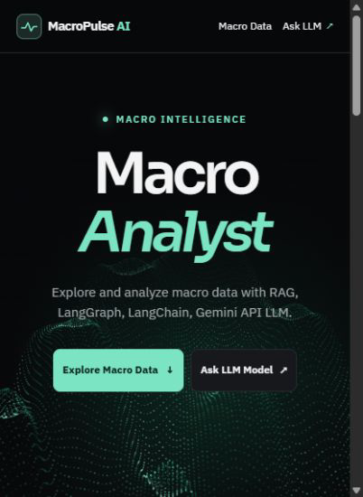
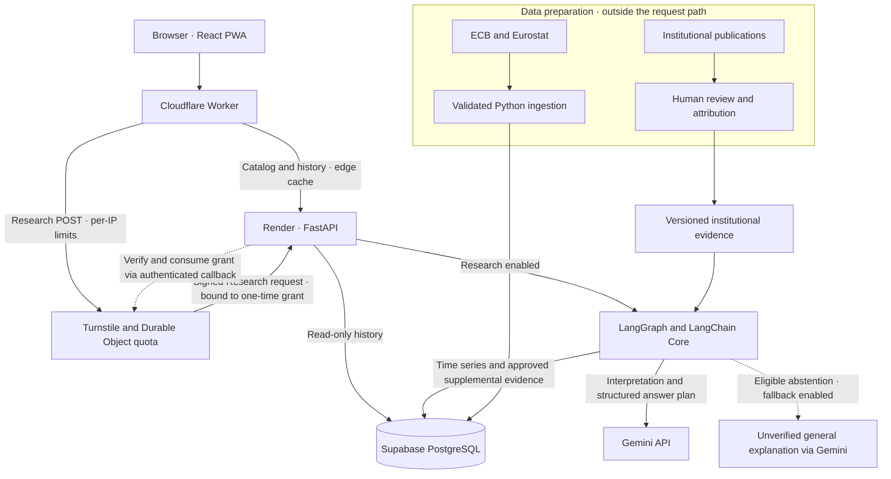
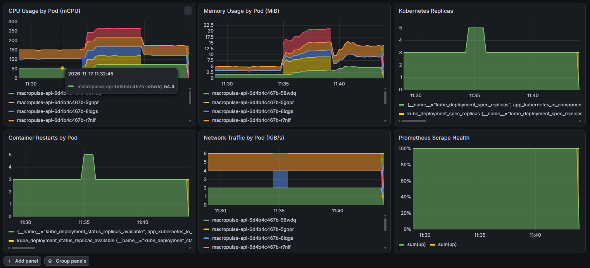

# MacroPulse AI

MacroPulse AI is an AI-powered research workspace for the euro area. The installable web app charts official ECB and Eurostat history and uses retrieval-augmented generation (RAG) to explain past events with attributed institutional evidence and reproducible, deterministic calculations.

**[Open the live demo](https://macropulse-public-demo.mauricio-casaco.workers.dev/)**



## Key capabilities

Explore interactive historical charts by indicator and period. Inspect exact observations by mouse, touch, or keyboard. Charts show units, source links, reuse terms, and update timestamps when available. The deposit rate chart shows when a rate applied within verified coverage. The responsive progressive web application (PWA) can be installed on supported browsers and caches its app shell.

**Pause motion** stops the decorative animation. The ocean scene loads on demand and uses a static view when WebGL is unavailable or reduced motion is requested. Vite generates bundled dependency notices in `frontend/dist/.vite/license.md`.

| Indicator | Source | Frequency and unit |
| --- | --- | --- |
| EUR/USD reference rate | ECB | Daily, US dollars per euro |
| Real GDP growth | Eurostat | Quarterly, percent change from the previous quarter |
| Headline HICP inflation | Eurostat | Monthly, percent change from the same month a year earlier |
| M3 money stock | ECB | Monthly, millions of euros |
| ECB deposit facility rate | ECB | Effective-date changes, percent per year |

Choose an indicator and a preset event or custom dates to scope a research question. The public form presents an explicit consent step before a question can be shared with Gemini. Research availability depends on the deployed feature flags and admission controls.

| Answer mode | What the app returns |
| --- | --- |
| **RAG-Based LLM Answer** | Research grounded in supported official observations, deterministic statistics, and reviewed institutional claims where available. The workflow checks the scope and evidence, attributes citations, and returns partial results or abstains when support is insufficient. |
| **Pure LLM Answer** | An optional Gemini explanation after an eligible RAG abstention, when enabled on the public backend. The explanation is labelled unverified, receives no retrieved evidence or calculation results, and appears alongside the original RAG result. A technical failure in RAG does not trigger this mode. |

## Technology stack

| Responsibility | Implementation |
| --- | --- |
| Frontend | React 19, TypeScript 6, Vite 8, uPlot for charts, Three.js, GSAP, and Lenis for the motion-enabled interface |
| Backend | Python 3.12, FastAPI, Pydantic, psycopg |
| AI orchestration | LangGraph 1.2 and LangChain Core 1.7 |
| Language model | Gemini Developer API through a bounded HTTP client in the public profile. The checked-in Render manifest selects Gemini 3.5 Flash-Lite; the deployed model can differ if overridden in Render. |
| Retrieval | TF-IDF ranking over versioned, human-reviewed claims with topic, geography, date, and eligibility filters |
| Data engineering | Python ingestion from ECB and Eurostat, PostgreSQL capture and revision tracking, Supabase read-only views |
| Cloud and security | Cloudflare Workers, Turnstile, per-visitor/global quotas in a SQLite-backed Durable Object, single-use HMAC origin attestations for Research, and FastAPI on Render |
| Testing and CI | pytest, Vitest, Node.js Worker tests, GitHub Actions, CodeQL, pip-audit, npm audit, and Gitleaks |

See the [frontend manifest](frontend/package.json) and [public backend requirements](backend/requirements-public-research.txt) for exact pins.

## Production architecture



The Worker serves the PWA and proxies same-origin API requests to an authenticated Render origin. It can cache validated catalog and history reads at the edge. Public research submissions pass through per-IP attempt limits, Turnstile verification and an atomic quota reservation. The Worker signs each Research request with an HMAC bound to its request bytes and reserved grant; Render authenticates the request and verifies one-time grant consumption through an HTTPS callback before processing Research. The older shared origin secret remains limited to catalog/history reads. The backend reads persisted observations through restricted Supabase views. ECB and Eurostat retrieval happens during ingestion, outside the interactive request path.

On Render, the research graph validates a question against the supported catalog and time window, reads observations, computes statistics, and retrieves evidence. Gemini can interpret custom questions and propose the order and style of approved statements. The server validates the plan and builds the cited answer from those statements. It can render a deterministic summary when drafting fails and verified evidence is available. The optional general explanation is a separate branch after an eligible abstention.

Public Research availability is controlled at the Worker and origin. Dynamic editorial retrieval and supported as-of queries are also flag-controlled on the backend. The standard local RAG flow uses Gemini for citation selection. The experimental local Research v2 profile requires explicit activation on loopback, and E5 retrieval is an optional local experiment. [Deployment runbook](docs/public-deployment-runbook.md) · [Local Research v2 guide](docs/research-v2.md)

## Engineering Highlights

- **Bounded orchestration and output validation.** LangGraph gates a fixed set of read operations behind scope checks. The model supplies structured intent and presentation choices. The server checks the plan, statement IDs, and citations before rendering, which limits the effects of malformed model output.
- **Deterministic statistics and provenance.** Python computes comparisons from dated observations using series-specific definitions and units. Responses retain source links, dates, capture information, and calculation inputs where available. That makes a result traceable to the data and revision used. [Series contracts](docs/macro/official-series-contracts.md) · [Data reuse policy](docs/macro/data-reuse-policy.md)
- **Reviewed retrieval.** The current versioned corpus contains 30 institutional documents and 53 approved claims. Claim metadata preserves scope, publication dates, attribution, and source locators. Ranking and support checks keep contextual evidence within its stated scope. [Corpus and editorial review](resources/evidence/m7b/README.md)
- **Admission and timeout budgets.** A SQLite-backed Durable Object checks per-visitor and global quotas and reserves concurrent capacity in one transaction. The configured Worker fetch window is 70 seconds, the origin research deadline is 65 seconds, and the quota lease expires after 90 seconds. Confirmed completion frees capacity early. Uncertain completion holds the lease until expiry, which bounds concurrency at the cost of temporary capacity. [Timeout configuration](docs/public-deployment-runbook.md#presupuesto-temporal-de-research)
- **Single-use Research authorization (Fase 12.S1).** Body-bound HMAC-SHA256 origin attestations, expiration checks and single-use Durable Object grant consumption defend the Research endpoint against direct origin requests and replay; the read-only catalog/history routes retain separate shared-secret authentication. [Protocol](docs/security/fase-12-s1-contract.md) · [Verification](docs/security/fase-12-s1-verification.md)
- **Sensitive-input and provider-egress controls (Fase 12.S3).** Recognizable secrets and personal-data formats are rejected before Research SQL or Gemini. Provider-bound fields are projected by stage, and structured logs exclude question text and credentials. These are pattern-based and tested with synthetic cases, not a guarantee against all disclosures. [Contract](docs/security/fase-12-s3-contract.md) · [Verification](docs/security/fase-12-s3-verification.md)
- **Research intent admission (Fase 12.S4).** A deterministic policy rejects recognized instructions to override controls, run code/SQL, or exfiltrate data before the Research workflow. Legitimate economic analysis remains eligible, but paraphrase and obfuscation coverage is incomplete. [Contract](docs/security/fase-12-s4-contract.md) · [Verification](docs/security/fase-12-s4-verification.md)
- **Scoped database access.** FastAPI uses a dedicated reader, restricted views, read-only transactions, and PostgreSQL TLS with hostname and CA verification. Startup and connection checks test the reader's effective role and grants. [Security policy](SECURITY.md)

## Local Kubernetes & observability

A separate Windows 11 environment runs **three FastAPI replicas** on **Kubernetes (kind + Docker Desktop)**. **Prometheus**, **kube-state-metrics**, and **Grafana** expose container CPU, memory, replica availability and other cluster health signals. One-click PowerShell scripts manage the existing local cluster and loopback-only dashboards. **This is separate from the Cloudflare/Render production deployment.**



[View Kubernetes pod/deployment evidence](kubernates_local/screenshots/kubernetes-pods.png) · [Local setup, operations and monitoring queries](kubernates_local/README.md)

## Local development

Use **Python 3.12** and **Node.js 24.15+ in the 24.x line**. The frontend also declares compatible Node 22 and 26+ releases. From the repository root, create a virtual environment and activate it with `source .venv/bin/activate` on POSIX shells or `.\.venv\Scripts\Activate.ps1` in PowerShell.

```sh
python -m venv .venv
# Activate the environment before installing.
python -m pip install -r backend/requirements-ai.txt -r requirements-m7b.txt
npm --prefix frontend ci
```

For historical data, set `MACRO_API_DSN` in the backend terminal to an authorized read-only connection to a populated loopback PostgreSQL database. The default `MACRO_API_MODE` is `loopback`. Enable local research by setting `MARKETPULSE_MACRO_AI_ENABLED=true` in both terminals and providing `GEMINI_API_KEY` to the backend only. See the [series contracts and local ingestion commands](docs/macro/official-series-contracts.md#ingesta-local) and the [Windows guide](docs/development/windows.md) for PowerShell startup, shortcuts, and private LAN testing.

Start the backend and frontend in separate terminals from the repository root, then open [the local app](http://127.0.0.1:5173/).

```sh
python -m uvicorn backend.api:app --host 127.0.0.1 --port 8000
```

```sh
npm --prefix frontend run dev
```

### Repository layout

| Path | Contents |
| --- | --- |
| [backend/](backend/) and [frontend/](frontend/) | FastAPI, research and retrieval, PWA, and Cloudflare Worker |
| [resources/evidence/](resources/evidence/) | Versioned discovery inputs and editorial corpus |
| [tests/fixtures/retrieval/](tests/fixtures/retrieval/) | Frozen retrieval, regression, and holdout benchmarks |
| [scripts/](scripts/), [supabase/](supabase/), [.github/](.github/), and [render.yaml](render.yaml) | Development tools, SQL, CI, and origin configuration |
| [docs/](docs/) and [assets/](assets/) | Operating guides, data contracts, and product screenshots |
| [kubernates_local/](kubernates_local/) | Local kind cluster operations, Prometheus/Grafana queries and real monitoring captures (not production) |

Git ignores local `data/` outputs, including financial backfills, model artifacts, SQLite indexes, and benchmark results. [Evidence rebuild instructions](resources/evidence/m7b/README.md#reproducir-y-verificar) and the [retrieval evaluation guide](docs/retrieval-evaluation.md) cover regeneration.

### Run the tests locally

With test database DSNs unset, run the fixture-backed suite from the repository root. Use the [disposable PostgreSQL guide](docs/market-data-postgres.md#local-tests) for database integration tests. The [frontend guide](frontend/README.md) covers local Vite development and the separate market archive workspace.

```sh
python -m pytest -ra
npm --prefix frontend test
npm --prefix frontend run test:worker
npm --prefix frontend run lint
```

## Testing, security, and deployment

GitHub Actions defines Python and frontend checks for pull requests and pushes to `main`. CI runs pytest with fixtures, Vitest, Worker tests, lint, and local and public PWA builds. CodeQL analyzes Python and JavaScript/TypeScript, Gitleaks scans for exposed secrets, and pip-audit and npm audit check dependencies, including on a weekly schedule. Cloudflare and Render releases are manual. [CI and security checks](docs/devsecops.md) · [Deployment and rollback](docs/public-deployment-runbook.md)

The PWA caches its shell, and Research responses use `no-store`. Fase 12.S1 replaced the shared-secret admission path for **Research** with HMAC attestations and one-time grant consumption; S3 added sensitive-input filtering and restricted Gemini payloads; S4 added policy-based intent checks. Offline and synthetic verification does not prove the same controls or environment flags are enabled in the hosted deployment. Recognizable patterns can be missed, reviewed evidence can still be wrong, and the unverified fallback remains subject to output-validation limits. [Security policy](SECURITY.md) · [Known risks](SECURITY.md#known-risks)

## Research limitations

- Corpus coverage is limited by indicator, event, geography, and publication date. Some questions have enough data for a statistical summary and limited documentary support.
- The workspace studies historical data. Descriptive changes and correlations cannot establish causal effects or support forecasts.
- Model interpretation can miss a qualifier even when a plan passes validation. Institutional interpretations stay attributed to their sources, and general Gemini explanations remain unverified. Rule-based sensitive-input and research-intent admission cannot detect every adversarial or private input. [Research v2 review](docs/research-v2.md#limitaciones-conocidas)
- Observation periods, publication dates, and capture timestamps represent different events. A document cutoff can restrict eligible sources while the selected series still includes later revisions. Historical windows alone cannot reconstruct the information available on a given date.
