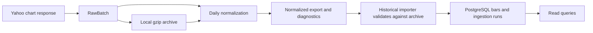

# Market data architecture and contract

The daily pipeline separates provider acquisition, validation and storage.
This keeps provider-specific conventions out of consumers and makes an
archived import reproducible.

`catalog.py` defines the assets and provider mappings. `yahoo_adapter.py`
captures raw chart values and `normalizer.py` applies mapping-specific
label and price rules. `pipeline.py` coordinates acquisition and storage
for one mapping. `backfill.py` produces local archives and normalized
exports. `historical_import.py` verifies those files and persists batches
through `PostgresPriceRepository`. The [PostgreSQL guide](market-data-postgres.md)
covers the migration runner, import operations and DEV audit.

## Supported instruments

| Yahoo symbol | Asset ID | Native unit | Daily date label |
| --- | --- | --- | --- |
| GC=F | `gold_future` | USD/troy ounce | Yahoo-published futures date in New York |
| CL=F | `wti_future` | USD/barrel | Yahoo-published futures date in New York |
| ^GSPC | `sp500_index` | Index points | U.S. equity session date in New York |
| VT | `world_equity_etf` | USD/share | U.S. equity session date in New York |
| VWO | `emerging_markets_etf` | USD/share | U.S. equity session date in New York |
| BTC-USD | `bitcoin_usd` | USD/BTC | UTC date, including weekends |

A provider mapping identifies the asset, provider and symbol. The
[Yahoo evidence](market-data-yahoo.md) explains the observed label rules
and the limits of each convention.

## Daily OHLCV and provenance

`PriceBar1d` carries a daily provider date, separate price fields and
provenance. Ranges use `[start, end_exclusive)` on provider dates.

| Field group | Contract |
| --- | --- |
| Identity | Mapping, asset, provider and symbol. Storage key is `(asset_source_id, interval, bar_date, ohlc_basis)`. |
| OHLC | Finite decimal values with mandatory `close`. Missing open, high or low yields a partial bar. Available prices must respect OHLC bounds. OHLC uses the provider's unadjusted basis. |
| Adjusted close | Separate optional decimal with a provider-reported basis when present. Missing adjusted close stays null. |
| Volume | Nonnegative decimal or null. Zero is an observed value and the mapping supplies the volume unit when known. |
| Sign | Prices are strictly positive except for WTI, which permits signed prices. |
| Provenance | UTC retrieval time, source convention, quality and session status, provider and adapter versions, and rolling method when applicable. |

Missing or invalid observations carry rejection diagnostics. No gap filling
or interpolation is performed. Raw archives preserve provider timestamps
and values. Normalized exports reference the original gzip by relative path
and SHA-256. PostgreSQL records the run that supplied the current content
and the run that most recently observed it. Keep the archives to recover
source metadata or superseded content.

## Known limits

The provider date and retrieval timestamp do not establish when a closing
price was available to a historical researcher. Official trading dates,
settlement times and availability timestamps remain unset. The reviewed
U.S. equity session calendar is bounded to the historical window. Futures
rolling methodology remains unknown. Compare raw observations in their
native units and keep provider calendars separate, especially when a
series can cross zero. Historical exports are local and outside the public
repository. Distribution of source data depends on the provider terms.
