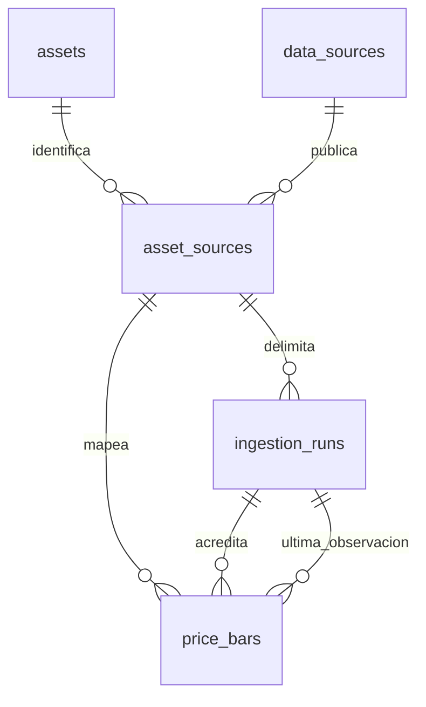
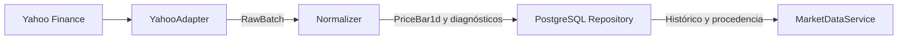

# Market Data Foundation

Fase 1.1 · Especificación para revisión independiente. Elaborada en modo SIMPLE
con un único agente por autorización excepcional. El esquema es conceptual y
requiere aprobación humana antes de implementar migraciones.

El módulo normaliza, conserva y expone observaciones históricas diarias con
identidad económica, unidades y procedencia. Esta fase define contratos internos
para Python 3.12 y PostgreSQL. La ingesta, las migraciones y la interfaz HTTP
corresponden a fases posteriores.

## Catálogo inicial

Cada activo tiene un ID estable, nombre, categoría, instrumento, moneda de
cotización cuando aplica, unidad económica, calendario y metadatos extensibles.
La relación con el proveedor vive en un catálogo de mapeos independiente.

| ID | Nombre | Categoría | Instrumento | Moneda | Unidad | Calendario | Política de signo | Ticker Yahoo |
| --- | --- | --- | --- | --- | --- | --- | --- | --- |
| gold_future | Oro | Materias primas | Futuro | USD | USD/troy_oz | Sesiones de futuros de oro | strictly_positive | GC=F |
| wti_future | Petróleo WTI | Materias primas | Futuro | USD | USD/bbl | Sesiones de futuros WTI | signed_allowed | CL=F |
| sp500_index | S&P 500 | Renta variable | Índice | NULL | index_points | Sesiones bursátiles de EE. UU. | strictly_positive | ^GSPC |
| world_equity_etf | Mercado mundial | Renta variable | ETF | USD | USD/share | Sesiones de cotización de VT | strictly_positive | VT |
| emerging_markets_etf | Mercados emergentes | Renta variable | ETF | USD | USD/share | Sesiones de cotización de VWO | strictly_positive | VWO |
| bitcoin_usd | Bitcoin | Criptoactivos | Criptomoneda spot | USD | USD/BTC | 24/7 | strictly_positive | BTC-USD |

GC=F y CL=F identifican referencias de futuros. Su metodología de rolling
queda en `unknown`. Hasta verificarla, el servicio advierte sobre la serie y
excluye cálculos de retornos que puedan cruzar un rollover. Los calendarios
identifican políticas de sesión. En 1.2 se verificarán las convenciones
exactas de Yahoo, incluidos cierres, festivos y el corte diario de Bitcoin.
La moneda NULL del índice refleja que el nivel se mide en puntos.

## Contrato PriceBar1d

Modelo inmutable, con tipos estándar y precios representados por `Decimal`.

| Campo | Tipo Python | Semántica |
| --- | --- | --- |
| asset_source_id | int | Referencia al mapeo que identifica activo, fuente y símbolo |
| bar_date | date | Etiqueta de la sesión según la convención verificada de la fuente |
| interval | Literal["1d"] | Frecuencia diaria |
| open, high, low | Decimal o None | Precios opcionales en la unidad del activo |
| close | Decimal | Cierre obligatorio en la unidad del activo |
| adjusted_close | Decimal o None | Cierre ajustado publicado por la fuente, separado de Close |
| volume | Decimal o None | Volumen en la unidad declarada por el mapeo, si está disponible |
| ohlc_basis | Literal["provider_unadjusted"] | OHLC solicitado con ajustes automáticos desactivados |
| adjusted_close_basis | Literal["provider_reported"] o None | Procedencia del ajuste, cuya metodología puede quedar pendiente |
| retrieved_at | datetime | Instante UTC consciente de zona, tomado al recibir el lote |
| session_status | Literal["closed", "provisional", "unknown"] | Estado al recuperar la barra |
| quality_status | Literal["complete", "partial"] | Cobertura de los cuatro valores OHLC |
| source_convention | str | Zona IANA y regla de etiquetado diario, o identificador de una convención verificada |

### Invariantes

- Una fecha diaria es un `DATE`. Conservar la etiqueta de sesión de la fuente
  sin sintetizar medianoche UTC. Una convención ambigua se rechaza antes de
  asignar la fecha. El instante de recuperación tiene semántica independiente.
- Rechazar NaN e infinitos en el modelo normalizado. El adaptador puede convertir
  un marcador de ausencia del transporte a NULL si su significado está
  documentado. Un valor presente inválido rechaza la fila y genera un diagnóstico.
- Exigir Close. Rechazar la fila con diagnóstico `missing_close` si falta,
  sin imputar el valor ni usar Adjusted Close como sustituto. Con Close
  válido, usar `partial` si falta Open, High o Low y `complete` si están los
  cuatro. Volume y Adjusted Close son opcionales en ambos casos.
- Comparar los pares presentes. Low ≤ High, Low ≤ Open y Close, y Open y
  Close ≤ High. Adjusted Close queda fuera de estas comparaciones.
- Aplicar la política de signo del activo a los precios presentes, incluido
  Adjusted Close. Para WTI se admiten negativos y cero. El volumen presente
  debe ser finito y ≥ 0. NULL significa ausencia y cero es un dato.
- Evitar forward-fill y filas inventadas para cubrir huecos. Clasificar como
  provisional una sesión potencialmente abierta al recuperar los datos.
  Usar `unknown` cuando el calendario o la evidencia no permitan determinarlo.
  El estado `closed` no impide correcciones históricas.

## Esquema conceptual PostgreSQL

| Entidad | Columnas y restricciones |
| --- | --- |
| assets | `id text PK`, `name text`, `category text`, `instrument_type text`, `quote_currency text NULL`, `economic_unit text`, `calendar_code text`, `sign_policy text`, `metadata jsonb`. CHECK sobre la política de signo y formato ISO de tres letras para moneda presente. |
| data_sources | `id text PK`, `name text`, `metadata jsonb`. ID inicial `yahoo_finance`. |
| asset_sources | `id bigint identity PK`, `asset_id text FK assets`, `source_id text FK data_sources`, `symbol text`, `source_convention text`, `volume_unit text NULL`, `rolling_method text NULL`, `metadata jsonb`. UNIQUE (source_id, symbol). Permite varios símbolos por activo y proveedor. |
| ingestion_runs | `id bigint identity PK`, `asset_source_id bigint FK asset_sources`, `interval text`, `start_date date`, `end_date_exclusive date`, `started_at timestamptz`, `finished_at timestamptz NULL`, `status text`, `adapter_version text`, `received_count bigint`, `inserted_count bigint`, `unchanged_count bigint`, `corrected_count bigint`, `stale_count bigint`, `rejected_count bigint`, `error_code text NULL`. UNIQUE (id, asset_source_id, interval) para la FK compuesta de barras. |
| price_bars | PK (asset_source_id, interval, bar_date, ohlc_basis), `asset_source_id bigint FK asset_sources`, `interval text`, `bar_date date`, `ohlc_basis text`, `open/high/low numeric NULL`, `close numeric NOT NULL`, `adjusted_close numeric NULL`, `adjusted_close_basis text NULL`, `volume numeric NULL`, `retrieved_at timestamptz`, `source_convention text`, `session_status text`, `quality_status text`, `run_id bigint`, `last_seen_at timestamptz NOT NULL`, `last_seen_run_id bigint NOT NULL`. FK (run_id, asset_source_id, interval) y FK (last_seen_run_id, asset_source_id, interval) a ingestion_runs (id, asset_source_id, interval). CHECK ((last_seen_at, last_seen_run_id) >= (retrieved_at, run_id)). |

Las columnas son NOT NULL salvo indicación. Los textos de identidad y unidad
son no vacíos. JSONB queda limitado a objetos de metadatos no esenciales para
claves, consultas, integridad o seguridad, con valor inicial vacío. Los mapeos
mantienen su identidad económica al actualizar metadatos. Una reasignación de
símbolo a otro instrumento requiere diseñar vigencias antes de admitirla.
Las FK restringen borrados de filas referenciadas.

Los CHECK de barras aplican frecuencia, bases, estados, finitud de cada
`numeric` presente (excluir NaN y ambas infinidades), volumen no negativo,
pares OHLC y coherencia entre NULL y estado de calidad o base de ajuste. La
política de signo depende de otra tabla. Validarla en el normalizador y en la
ruta transaccional de persistencia con la política vigente. En 1.4 se deberá
restringir escritura directa o aplicar esa regla en la base mediante un
trigger. Un cambio de política exige verificar las barras existentes.

En ejecuciones, exigir intervalo diario, rango creciente, contadores no
negativos y `finished_at >= started_at` cuando esté presente. Los estados son
`running`, `succeeded`, `partial`, `failed` y `abandoned`. Solo `running`
tiene fin NULL. Los resultados finalizados que procesaron el lote cuadran
recibidas con la suma de insertadas, corregidas, iguales, obsoletas y
rechazadas. Un lote vacío se registra con cero filas y diagnóstico de ausencia.
`partial` indica procesamiento con filas rechazadas y `failed` indica fallo
de adquisición o persistencia sin cambios confirmados en barras.

Índices mínimos adicionales a PK y UNIQUE: `asset_sources(asset_id)`,
`ingestion_runs(asset_source_id, started_at DESC)`,
`price_bars(run_id, asset_source_id, interval)` y
`price_bars(last_seen_run_id, asset_source_id, interval)`. La PK de barras soporta el
rango diario por mapeo y frecuencia. Revisar planes con datos sintéticos antes
de añadir índices específicos por base de precios.



### Escritura idempotente y concurrencia

1. Registrar una ejecución por mapeo y rango antes de adquirir el lote.
   Validar que cada barra esté dentro del rango solicitado. Colapsar duplicados
   idénticos del lote y contabilizar copias como iguales. Rechazar todas las
   filas de una clave con contenidos contradictorios dentro del mismo lote.
2. Dentro de una transacción, serializar escritores por mapeo con bloqueo de
   la fila de `asset_sources` y aplicar upsert por PK. Si la barra es nueva,
   insertar. Una observación posterior con valores, calidad, estado y
   convención iguales conserva la procedencia existente. Una corrección
   posterior reemplaza el contenido completo, incluido cualquier NULL, y
   actualiza `retrieved_at` y `run_id`. Comparar campos nullable con
   semántica `IS DISTINCT FROM`.
3. Para ordenar lotes concurrentes, comparar (retrieved_at, run_id). Mantener
   además por barra la mayor observación aceptada en
   `last_seen_at timestamptz NOT NULL` y `last_seen_run_id bigint NOT NULL`,
   con FK compuesta a ingestion_runs usando mapeo e intervalo. Una observación
   igual solo avanza esa marca. Una observación anterior a la marca se cuenta
   como obsoleta y no puede sobrescribir el contenido. Repetir la misma
   observación es un no-op. Al insertar o corregir, la marca coincide con
   (retrieved_at, run_id) del contenido guardado. En una observación igual
   posterior, la marca avanza sin cambiar la procedencia del contenido.
4. Confirmar escrituras y contadores finales juntos. Ante rollback, registrar
   el fallo en transacción separada. Una ejecución interrumpida que quede
   `running` requiere reconciliación antes de marcarla `abandoned`. Un nuevo
   intento tiene su propio ID y no duplica barras.

El repositorio conserva la última versión del contenido, no el historial de
versiones. `retrieved_at` identifica cuándo se observó el contenido vigente.
No usar esta vista como histórico point-in-time. Para análisis reproducibles
guardar una instantánea autorizada de las entradas y su procedencia. Antes
de backtests que requieran conocimiento histórico, diseñar versionado de
revisiones y reglas de disponibilidad para evitar look-ahead.

## Módulos e interfaces Python

```text
backend/market_data/
  __init__.py
  models.py         # dataclasses, tipos de dominio y resultados
  catalog.py        # activos y mapeos iniciales
  yahoo_adapter.py  # adquisición y traducción del transporte
  normalizer.py     # reglas de fecha, valores y calidad
  repository.py     # Protocol y persistencia PostgreSQL
  service.py        # consultas y coordinación de ingesta
```



```python
# Firmas de diseño, con dataclasses inmutables para los tipos de datos.
class PriceAdapter(Protocol):
    def fetch_daily(self, mapping: AssetSource, window: DateRange) -> RawBatch: ...

def normalize(batch: RawBatch, asset: Asset, mapping: AssetSource,
              window: DateRange) -> NormalizedBatch: ...

class PriceRepository(Protocol):
    def start_run(self, mapping_id: int, window: DateRange) -> int: ...
    def save_batch(self, run_id: int, batch: NormalizedBatch) -> RunSummary: ...
    def fail_run(self, run_id: int, code: str) -> RunSummary: ...
    def read_daily(self, mapping_id: int, window: DateRange) -> tuple[PriceBar1d, ...]: ...

PriceField = Literal["close", "adjusted_close"]

class MarketDataService:
    def ingest_daily(self, asset_id: str, window: DateRange, *,
                     source_id: str = "yahoo_finance") -> RunSummary: ...
    def list_assets(self) -> tuple[Asset, ...]: ...
    def get_history(self, asset_id: str, start_date: date, end_date_exclusive: date,
                    *, source_id: str = "yahoo_finance",
                    symbol: str | None = None,
                    price_field: PriceField = "close") -> PriceHistory: ...
    def get_last_months(self, asset_id: str, months: int, *,
                        end_date_exclusive: date, source_id: str = "yahoo_finance",
                        symbol: str | None = None,
                        price_field: PriceField = "close") -> PriceHistory: ...
```

`DateRange` contiene dos fechas con inicio estrictamente anterior al fin.
`Asset` y `AssetSource` reflejan el catálogo. `RawBatch` contiene el mapeo,
instante de recuperación, versión del adaptador y filas crudas de escalares
con etiquetas temporales originales. Solo el adaptador conoce pandas y yfinance.
`NormalizedBatch` contiene barras válidas y diagnósticos con códigos y
posiciones de fila, sin payloads completos en logs. `RunSummary` refleja el
estado y contadores persistidos. La ingesta resuelve un único mapeo y usa el
repositorio para registrar y finalizar cada intento.

`PriceHistory` devuelve activo e instrumento, proveedor y ticker, rango pedido,
frecuencia y convención, unidad y moneda, barras ordenadas por fecha, base OHLC,
calidad y procedencia por fila, y advertencias de parcialidad, provisionalidad,
huecos verificables o rolling desconocido. Incluye `queried_at` UTC como
instante de lectura, distinto de la recuperación de cada barra. La consulta lee
solo datos persistidos. Un rango válido sin datos devuelve una colección vacía.
Activo o mapeo desconocido, rango inválido y mapeo ambiguo son errores de dominio.
Si existe más de un símbolo para el activo y proveedor, exigir selección
explícita. FastAPI podrá traducir estos resultados y errores en otra fase.

Ambas consultas aceptan `price_field` y devuelven la selección junto con la
serie `(bar_date, Decimal | None)` derivada de las barras, en el mismo orden.
`close` es el valor predeterminado y cada barra persistida aporta un cierre.
`adjusted_close` conserva cada fecha de barra y devuelve NULL donde falte el
ajuste, con una advertencia de cobertura. Una serie ajustada sin ningún
valor conserva todos sus puntos nulos si existen barras. No hay fallback,
relleno ni descarte de fechas por ausencia de ajuste. La selección no
cambia `ohlc_basis` ni los campos de la barra.

Los rangos son `[start_date, end_date_exclusive)`. Los últimos N meses requieren
un entero positivo y usan una ventana móvil por calendario, anclada al fin
exclusivo explícito. Restar N meses del año y mes del fin conservando el día
cuando exista o limitándolo al último día del mes de destino. Rechazar fechas
fuera del rango representable.

## Requisitos del adaptador Yahoo para 1.2

Usar yfinance como cliente inicial de Yahoo Finance. Solicitar explícitamente
`auto_adjust=False`, `back_adjust=False`, `interval="1d"`, `start` inclusivo y
`end` exclusivo. Tratar Adjusted Close como opcional. Verificar las variantes
de columnas planas y MultiIndex, incluso para un solo símbolo. Seleccionar
campos por nombre y ticker y rechazar un resultado ambiguo.

Verificar zonas, fechas etiquetadas por el proveedor, corte de sesión y
convención de volumen. Distinguir error de transporte o proveedor, respuesta
vacía, símbolo inesperado y ausencia parcial de campos. Los reintentos
acotados se reservan para errores transitorios y conservan la trazabilidad.
Verificar el alcance de las referencias de futuros y su rolling antes de
derivar retornos. La prueba de estos contratos usa respuestas sintéticas.

## Ejemplos y verificaciones futuras

Todos los valores siguientes son sintéticos.

| Caso | Entrada | Resultado esperado |
| --- | --- | --- |
| WTI diario | O=-5, H=2, L=-8, C=-3, V=0 | Completa y válida, volumen cero |
| ETF parcial | O=10, H=NULL, L=9, C=11, Adj C=10.5, V=NULL | Parcial válida, cierre y ajuste separados |
| Cierre ausente | O=10, C=NULL, Adj C=11 | Rechazo con `missing_close` |
| Serie ajustada | C=11, Adj C=NULL en una barra válida | Punto NULL en la misma fecha y advertencia |
| OHLC inválido | O=12, H=11, L=9, C=10 | Rechazo aunque todos sean positivos |
| Bitcoin | Barra con fecha sábado 2025-03-01 | Fecha admisible en el calendario 24/7 |
| Ventana mensual | Un mes hasta 2025-03-31 exclusivo | Desde 2025-02-28 inclusive |
| Corrección | Mismo mapeo y fecha, cierre WTI pasa de -3 a -2 en un lote posterior | Una barra, contenido corregido y procedencia nueva |

La suite futura debe cubrir los seis IDs, mapeos, unidades y distinción entre
futuro, spot, índice, ETF y criptoactivo. Probar fechas de sesión, festivos,
cierres abiertos y Bitcoin en fin de semana, además de límites de rango y años
bisiestos. Incluir valores ausentes, ceros, NaN, infinitos, pares OHLC
incoherentes, cierre obligatorio incluso con ajuste presente, signo por activo y respuestas planas y MultiIndex. Verificar
duplicados, corrección de campos opcionales a NULL, lotes retrasados, rollback, reintentos y carreras
con PostgreSQL desechable y fixtures sintéticos. Comprobar procedencia, versión
del adaptador y ausencia de retornos cross-roll sin verificación. Mantener los
tests alejados de proveedores reales y bases productivas.

Tests de esta entrega: `not-applicable (docs-only)`. Las firmas y el esquema
son especificaciones sin comportamiento ejecutable.

## Roadmap propuesto y criterios de aceptación

| Fase | Criterio verificable |
| --- | --- |
| 1.2 · Integración Yahoo | Cliente simulado verifica los parámetros explícitos, símbolos, fechas y formatos. Las convenciones temporales documentadas se validan por mapeo y los errores se clasifican. Las incógnitas de rolling siguen identificadas. |
| 1.3 · Normalización | Fixtures reproducen el catálogo y las reglas OHLCV, incluidos WTI negativo, NULL frente a cero, ausencia de ajuste y fechas provisionales. Filas sin Close se rechazan con diagnóstico, incluso si tienen Adjusted Close. |
| 1.4 · PostgreSQL | Tras aprobación humana, una base local desechable confirma claves, checks, idempotencia, correcciones, orden de lotes, contadores y rollback. |
| 1.5 · Consultas | Pruebas de servicio comprueban rangos semiabiertos, meses calendario, orden, resultados vacíos, errores y procedencia completa sin depender de HTTP. Ambas consultas seleccionan Close o Adjusted Close y preservan los puntos nulos del ajuste sin fallback. |
| 1.6 · Calidad e integración | Suite sintética desde adaptador hasta consulta confirma invariantes, calendarios, ausencia de forward-fill y protección frente a retornos cross-roll sin verificar. |
| 1.7 · Preparación FastAPI | Contrato de serialización propuesto conserva decimales, fechas, UTC y NULL. Se documenta traducción de errores y se definen límites de consulta y acceso antes de exponer rutas. |

## Riesgos y decisiones pendientes

- Confirmar convención de fecha, calendarios, volumen, semántica de ajustes y
  rolling por símbolo. Un calendario sin verificar no sustenta diagnósticos
  de huecos ni definitividad.
- Aprobar esquema, política de escritura, retención y estrategia de
  instantáneas antes de implementar persistencia o backtests.
- Revisar las condiciones de acceso y redistribución de Yahoo antes del
  despliegue público de la PWA.
- Si se añaden datos de usuarios, definir autenticación, permisos y
  aislamiento por tenant antes de incorporarlos al módulo. Los contratos de
  esta fase describen referencias de mercado compartidas.
- La revisión independiente de esta especificación sigue pendiente.
