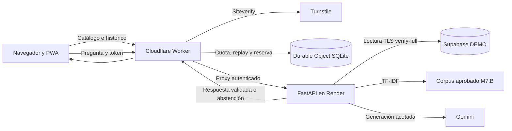

# Fase 8.1 · Preparación de la demo pública de MacroPulse AI

La demo pública presenta cinco series oficiales de la zona euro y habilita Research v2 mediante un perfil dedicado. La PWA y el API se sirven desde el mismo hostname HTTPS. Cloudflare recibe las solicitudes del navegador y autentica sus llamadas al origen Render. Render usa exclusivamente la proyección de Supabase DEMO, con TLS `verify-full` y un rol de lectura. Las cargas administrativas se ejecutan fuera de Render y se preparan con los archivos oficiales del BCE y Eurostat.

## Inventario de migración y compatibilidad

El inventario parte de `main` en `6caaf98`. Las decisiones se aplican a los archivos activos y a sus consumidores directos.

| Categoría | Archivos o superficie | Decisión y riesgo que cubre |
| --- | --- | --- |
| Naming público | `render.yaml`, `frontend/wrangler.jsonc` | Usar `macropulse-public-demo` para ambos servicios nuevos. Verificar que el destino de despliegue pertenece a DEMO. |
| Naming público | `frontend/src/`, `frontend/public/`, `frontend/pwa/`, `scripts/dev-all.ps1` | Mantener el nombre visible MacroPulse AI. Alinear referencias a los iconos entre manifest, shell y lanzador. Verificar tamaños, instalación y actualización del service worker. |
| Naming público | `AGENTS.md`, `.codex/config.toml`, `.codex/agents/` y guía de orquestación | Describir el proyecto macroeconómico. Preservar las reglas de roles, autorización, privacidad y auditoría. |
| Identificador técnico | `MARKETPULSE_*` en `.env.example`, `backend/api.py`, `backend/macro_data/`, `backend/macro_ai/`, `scripts/dev-backend.py`, `scripts/dev-all.ps1`, `frontend/vite.config.ts` y `frontend/pwa/local-*.ts` | Conservar la configuración de desarrollo y sus pruebas. El perfil DEMO admite únicamente sus propias credenciales de datos y de IA. |
| Identificador técnico | `x-marketpulse-*` en `backend/public_demo.py`, `frontend/worker/` y las pruebas de los dos extremos | Conservar cabeceras de autenticación y cliente entre Worker y Render. El Worker fija sus valores y excluye los valores que aporte el visitante. |
| Identificador técnico | `marketpulse_demo` y `marketpulse_demo_ro` en `supabase/demo/`, `backend/public_demo.py` y `backend/macro_data/public.py` | Conservar nombres de esquema y rol para mantener la validación de destino y privilegios. El esquema público se aprovisiona desde cero en el proyecto DEMO. |
| Identificador técnico | `frontend/package*.json`, `frontend/pwa/service-worker.js`, `frontend/README.md`, `scripts/Invoke-MarketPulseCodex.ps1`, `scripts/CodexTelemetry.ps1`, `scripts/codex_telemetry.py` y `docs/codex-telemetry.md` | Conservar el nombre privado del paquete, prefijo de caché, reglas de firewall local y nombres consumidos por el lanzador de Codex y su telemetría. Los cuatro `.bat` de MacroPulse resuelven rutas desde su propia ubicación. |
| Histórico | `backend/analysis.py`, `backend/market_data/`, `backend/news/`, rutas del explorador en `backend/api.py`, `supabase/demo/synthetic.sql`, `docs/phase-4.4a-public-readiness.md`, `docs/market-data-*` y `docs/news-*` | Preservar herramientas, pruebas y referencias históricas. El perfil MacroPulse publicado carece de rutas del explorador y usa una proyección de datos oficiales. |
| Histórico | `docs/macro/*` de migraciones y revisiones, rutas de worktrees `*/MarketPulse-AI`, `docs/m7c/`, `docs/m7d/` y `scripts/m7a_discovery.py` | Conservar la procedencia de los trabajos y los worktrees históricos en sus rutas actuales. Los nombres heredados de opciones M7 corresponden a ejemplos y scripts reproducibles. |
| Configuración obsoleta | `docs/public-deployment-runbook.md`, `docs/public-data-policy.md`, flags de Fase 4, exposición de `/assets` y del análisis financiero | Usar el procedimiento de 8.2 y el contrato macroeconómico de esta fase. Mantener la denegación de rutas históricas en el Worker. |

## Datos y contrato público

| Indicador | ID | Fuente y unidad |
| --- | --- | --- |
| EUR/USD | `eur-usd` | BCE EXR, dólares estadounidenses por euro |
| PIB real | `real-gdp-qoq` | Eurostat `namq_10_gdp`, variación porcentual intertrimestral sin anualizar |
| Inflación general | `hicp-yoy` | Eurostat `prc_hicp_minr`, variación porcentual interanual |
| M3 | `m3-stock` | BCE BSI, saldo al cierre de mes en millones de EUR |
| Facilidad de depósito | `deposit-rate` | BCE FM, porcentaje anual desde la fecha efectiva de cada evento |

Las series conservan períodos, fecha de captura, estado y procedencia. El catálogo operativo de [contratos](../backend/macro_data/contracts.py) fija las claves exactas, unidades y transformaciones. La [política pública](public-data-policy.md) detalla los usos admitidos. Una captura actual puede incluir revisiones. Las fechas de período, publicación, entrada en vigor y captura tienen significados distintos. Las respuestas de Research preservan esa distinción y se abstienen cuando la evidencia disponible es insuficiente.

La demo atribuye las series a su fuente y distingue los cálculos de la aplicación. Las paráfrasis institucionales y los hechos estructurados se limitan a lo aprobado en M7.B. Los documentos originales, materiales de terceros y entradas con derechos pendientes quedan fuera del contexto enviado a Gemini y de la proyección. [Política del BCE](https://www.ecb.europa.eu/services/using-our-site/disclaimer/html/index.en.html) · [Reutilización de Eurostat](https://ec.europa.eu/eurostat/help/copyright-notice) · [Aviso de la Reserva Federal](https://www.federalreserve.gov/disclaimer.htm) · [Revisión editorial M7.B](m7b/README.md)

| Método y ruta del Worker | Contrato |
| --- | --- |
| `GET /api/macro/indicators` | Catálogo de los cinco indicadores y disponibilidad de Research. |
| `GET /api/macro/indicators/{indicator_id}/history` | Historial oficial para `start` y `end`, con metadatos y cobertura de la tasa de depósito cuando corresponde. |
| `POST /api/macro/analysis` | JSON con `research_version: "v2"`, `question` de 5–500 caracteres, `indicator_id` del catálogo, `event_id`, `start` y `end`. El navegador envía `X-MacroPulse-Turnstile` y `Origin` del mismo sitio. La respuesta estructurada incluye hechos, cálculos, limitaciones, evidencia y citas, o una abstención. |

Los eventos públicos fijan sus ventanas de investigación. `covid` cubre del 1 de febrero al 31 de diciembre de 2020, `ukraine` del 1 de febrero de 2022 al 29 de febrero de 2024 y `generative-ai` del 1 de septiembre de 2023 al 30 de septiembre de 2026. Los históricos son independientes de esas ventanas y admiten rangos de hasta 2.600 días de calendario. El Worker elimina el prefijo `/api` al solicitar la ruta del origen autenticado.

El catálogo anuncia la clave pública en `X-MacroPulse-Turnstile-Sitekey` cuando habilitan Research el Worker y Render. Las respuestas API usan `Cache-Control: no-store`. El POST devuelve `403` por verificación u origen inválido, `422` por campos inválidos, `429` por cuota o presupuesto, `503` por saturación o indisponibilidad y `504` por timeout. Cuando hay tiempo de reintento calculado, el Worker envía `Retry-After`.

El servicio preserva los contratos de [Research v2](m7d/research-v2.md). El flujo público recupera evidencia con TF-IDF del corpus aprobado M7.B. Las estadísticas salen del repositorio DEMO y los cálculos se verifican contra evidencia; Gemini recibe únicamente entradas de investigación y evidencia seleccionada. El consentimiento se muestra antes del envío.

## Configuración por servicio

| Servicio | Variable o binding | Uso |
| --- | --- | --- |
| Render | `MARKETPULSE_MODE=public_demo`, `MARKETPULSE_DEMO_ANALYSIS_ENABLED=false` | Perfil dedicado y análisis financiero heredado deshabilitado. |
| Render | `MARKETPULSE_DEMO_PROJECT_REF`, `MARKETPULSE_DEMO_DSN`, `MARKETPULSE_DEMO_SSL_ROOT_CERT` | Referencia DEMO, DSN secreta del rol `marketpulse_demo_ro` y archivo CA montado. La DSN se limita a host, puerto, base, rol y contraseña. |
| Worker y Render | `MARKETPULSE_DEMO_ORIGIN_SECRET` | Secreto compartido aleatorio de 32 bytes representado con 64 dígitos hexadecimales. Worker lo fija en la solicitud al origen. |
| Worker | `MARKETPULSE_DEMO_ORIGIN_URL` | URL HTTPS del servicio Render. |
| Worker | `MARKETPULSE_DEMO_MACRO_ENABLED=true` | Habilita catálogo e históricos oficiales. El apagado de Research usa su propio interruptor. |
| Render | `MARKETPULSE_DEMO_RESEARCH_ENABLED`, `MARKETPULSE_DEMO_GEMINI_MODEL`, `MARKETPULSE_DEMO_GEMINI_API_KEY` | Interruptor, modelo permitido y clave Gemini secreta del proyecto dedicado. |
| Worker | `MACROPULSE_RESEARCH_ENABLED`, `MACROPULSE_RESEARCH_HOSTNAME` | Interruptor del borde y hostname HTTPS exacto del widget. |
| Worker | `MACROPULSE_TURNSTILE_SITE_KEY`, `MACROPULSE_TURNSTILE_SECRET` | Clave pública del widget y secreto server-side de Siteverify. |
| Worker | `MACROPULSE_RESEARCH_HASH_KEY` | Secreto aleatorio independiente para seudonimizar al visitante de cuota. |
| Worker | `RESEARCH_QUOTA`, `CATALOG_RATE_LIMIT`, `HISTORY_RATE_LIMIT`, `ASSETS` | Instancia SQLite global para Research, límites de lectura por ruta y archivos estáticos. |
| Carga administrativa | `MARKETPULSE_DEMO_ADMIN_DSN`, `MARKETPULSE_DEMO_PROJECT_REF`, `MARKETPULSE_DEMO_SSL_ROOT_CERT` | Conexión de escritura a DEMO autorizada por separado. Estas credenciales se mantienen fuera de Render y Cloudflare. |

La configuración desplegada parte de Research apagado. Los secretos Gemini, Turnstile, autenticación de origen y acceso a DEMO se cargan en las plataformas que los consumen. El navegador recibe la clave pública del widget cuando Worker y Render confirman disponibilidad.

## Límites y gasto

Los límites iniciales son 3 investigaciones por visitante en una ventana de 10 minutos, 10 por visitante al día, 100 globales al día y 2 ejecuciones globales concurrentes. El Durable Object centraliza la decisión antes de llamar al origen. Una cuota de investigación agotada, un fallo de Turnstile o el apagado de Research dejan disponibles el catálogo, los gráficos y el shell.

Los límites diarios y mensuales usan UTC. Cada admisión reserva una plaza hasta que Render confirma que terminó o vence la reserva de 60 segundos. El Worker espera hasta 28 segundos al origen. Render limita el flujo a 23 segundos y rechaza una reserva que no deje margen para completarlo. Una respuesta incierta, cancelación o timeout mantiene la plaza hasta su vencimiento. Las solicitudes con el interruptor apagado dejan de admitirse. Las investigaciones que ya alcanzaron el origen pueden terminar dentro de sus límites.

Siteverify verifica el token con Cloudflare y se comprueban el hostname, la acción `research` y la antigüedad de cinco minutos. SQLite registra la huella SHA-256 del token antes de admitirlo y cubre la consistencia eventual de Siteverify ante usos simultáneos. Los identificadores por visitante son HMAC de IP. Una alarma depura los tokens, reservas y registros de cuota vencidos. El presupuesto mensual conserva solo el agregado. [Validación de Turnstile](https://developers.cloudflare.com/turnstile/get-started/server-side-validation/)

Cada investigación admite hasta dos solicitudes de generación y dos de conteo. Por generación, el límite es 8.000 tokens de entrada con margen para el esquema y 2.400 de salida, con validación del consumo reportado y del razonamiento. Los modelos permitidos son `gemini-3.6-flash` y `gemini-3.5-flash-lite`. El cliente usa texto y salida estructurada sin herramientas ni reintentos.

El presupuesto operativo inicial es USD 10 al mes con un objetivo máximo de USD 15. El Durable Object reserva USD 0,10 por investigación admitida, incluso si falla, y bloquea al alcanzar 100 reservas en el mes UTC. A tarifas Standard de USD 1,50 por millón de tokens de entrada y USD 7,50 por millón de salida, dos generaciones con los límites configurados estiman USD 0,06. En 8.2, verificar las tarifas vigentes, establecer alertas y configurar el tope de proyecto si está disponible. Google advierte que su control de proyecto puede tardar en reflejar el consumo y permitir sobrecostes durante ese intervalo. El presupuesto de la aplicación y el del proveedor tienen coberturas distintas y no constituyen un límite monetario exacto. [Precios de Gemini](https://ai.google.dev/gemini-api/docs/pricing/) · [Facturación y topes](https://ai.google.dev/gemini-api/docs/billing)

Antes de habilitar Research en 8.2, verificar las condiciones del plan, la audiencia y las regiones admitidas por Google. Para usuarios del EEE, Suiza o Reino Unido, los términos de Gemini exigen el servicio de pago. Google indica que el servicio de pago puede conservar temporalmente preguntas y respuestas para detectar abuso. La información al usuario debe reflejar la configuración efectiva. [Términos de Gemini API](https://ai.google.dev/gemini-api/terms) · [Retención](https://ai.google.dev/gemini-api/docs/zdr)

## Aprovisionamiento y reversión de 8.2

1. Obtener autorización para los destinos reales y confirmar que el identificador DEMO difiere de DEV. Crear un proyecto aislado, instalar el esquema, cargar el snapshot aprobado con el procedimiento administrativo y repetir la importación para verificar idempotencia. Comprobar con la identidad de Render los grants efectivos y la conexión TLS. [TLS de Supabase](https://supabase.com/docs/guides/platform/ssl-enforcement) · [Conexión y pooler de sesión](https://supabase.com/docs/guides/database/connecting-to-postgres)
2. Desplegar Render y el Worker con Research apagado. Verificar HTTPS, origen autenticado, rechazo directo, ausencia de rutas retiradas y servicio de catálogo e históricos. Instalar la PWA y comprobar manifest, iconos y actualización del shell.
3. Configurar un widget Turnstile restringido al hostname aprobado y una clave Gemini para el proyecto DEMO. Revisar precio, alertas y telemetría sin preguntas, IP completas ni secretos. Confirmar que el Durable Object usa almacenamiento SQLite y mantiene el estado tras la recarga del Worker. [Almacenamiento del Durable Object](https://developers.cloudflare.com/durable-objects/best-practices/access-durable-objects-storage/)
4. Habilitar Research en los dos servicios y verificar desde el hostname una consulta real controlada, una abstención, replay, cuotas, saturación, timeout y el interruptor de emergencia. Registrar resultados sanitizados. Los pasos operativos y nombres de configuración se mantienen en el [runbook público](public-deployment-runbook.md).

La carga se divide en `python -m backend.macro_data.demo_import capture <carpeta> --start 2018-01-01` para descargar de las cinco rutas oficiales, `python -m backend.macro_data.demo_import import <carpeta>` para validar de forma offline, y la misma orden `import` con `--apply --project-ref <ref-DEMO>` para promover el snapshot autorizado. El bundle registra claves, ventana, fechas de captura y SHA-256 de cada respuesta. Mantener el bundle aprobado fuera del repositorio para reproducir y verificar la carga.

La promoción vincula cada serie con un conteo y una huella SHA-256 de la proyección ordenada, sus valores, fechas, estados, cobertura y procedencia. El lector valida la huella dentro de la misma transacción de lectura. Una fila faltante o alterada bloquea el servicio de la proyección. Reaplicar el bundle activo verificado conserva una proyección íntegra y repara en una transacción las diferencias detectadas en sus filas.

Para revertir Research, apagar su acceso en el Worker y en Render, comprobar que un POST queda bloqueado y que los GET oficiales siguen disponibles. Conservar la identidad y el estado del Durable Object durante la reversión para mantener el presupuesto consumido. Si falla la proyección, suspender el acceso de Render, validar offline el bundle previo aprobado y aplicar `import <carpeta-previa> --apply --project-ref <ref-DEMO> --restore-from <sha256-activo>`. La restauración requiere que el hash de la proyección activa coincida dentro de la transacción. Verificar el rol, el catálogo y los historiales antes de reabrir el acceso. Si hay exposición de un secreto, revocarlo y rotarlo en los servicios que lo usan. Para retirar toda la demo, desasociar el hostname público y suspender Render y el rol DEMO.

## Pruebas de aceptación

| Superficie | Verificación local | Pendiente en 8.2 |
| --- | --- | --- |
| PWA y compatibilidad | Suite frontend, lint, TypeScript, builds local y público, manifest, dimensiones de iconos y rutas relativas de los lanzadores. | Instalación y actualización desde el hostname real, HTTPS y navegación en navegador móvil. |
| Datos y roles | PostgreSQL desechable en loopback con TLS `verify-full`, fixtures sintéticos y verificación de grants efectivos, catálogo, unidades, procedencia, carga idempotente y aislamiento. | Proyecto DEMO real, CA del proyecto, grants de Supabase, acceso mediante el pooler si corresponde, captura autorizada y aprobación de cobertura. |
| Worker y acceso | Validación de solicitudes, rechazo directo, aislamiento de cabeceras, cuotas, simultaneidad, persistencia, expiración, replay y apagado de Research con históricos disponibles. | Widget y Siteverify con claves del hostname real, límites observados desde el borde, reinicio/despliegue sin perder presupuesto y política efectiva de registros. |
| Research v2 | Gemini simulado, evidencia y citas M7.B, verificación estadística y abstención, límites de tiempo y tokens, errores simulados y entorno de Render sin E5 ni PyTorch. | Consulta real controlada, latencia en frío de Render, comportamiento de `countTokens` y salida estructurada con el modelo aprobado, uso observado en facturación y alertas. |

La suite completa de Python pasó **821 pruebas** con PostgreSQL 17.11, `pgvector` 0.8.7 y TLS `verify-full` en loopback. La única omisión fue la prueba opcional del caché E5 de M7.C, que requiere `M7C_TEST_MODEL_CACHE`. El perfil público usa TF-IDF. La suite de frontend pasó **150 pruebas** y la de Worker **13**. Pasaron lint, TypeScript, los builds local y público y el empaquetado en seco de Wrangler 4.161.0. Los dos builds verificaron nueve recursos del shell con sus huellas y los tres iconos del manifest.

En `workerd` local, con Siteverify y Render simulados, se verificaron la ruta pública, la disponibilidad del catálogo al apagar Research y la persistencia de admisiones, replay y concurrencia tras reiniciar SQLite. En un entorno nuevo con las dependencias de Render cargaron LangGraph, TF-IDF y los 24 documentos y 47 afirmaciones del corpus aprobado.

Las regresiones de integridad cubren la pérdida de un evento de depósito, cambios numéricos con igual número de filas, alteración de cobertura, estabilidad de la huella entre configuraciones de sesión y reparación idempotente. Las pruebas de Siteverify cubren el rechazo de una respuesta superior a 4 KiB, incluida la transmisión por fragmentos, y el plazo aplicado a la lectura del cuerpo.

La promoción a 8.2 requiere el cierre de las pruebas locales y el dictamen de auditoría independiente según el umbral de `AGENTS.md`. La autorización de los servicios y la verificación de infraestructura se tramitan en 8.2.

## Riesgos residuales

- La cuota por IP puede agrupar visitantes de una red compartida y variar si un visitante cambia de red. Los topes globales siguen aplicándose. En Cloudflare, confirmar que la IP provenga del borde y que otros Workers de la zona carezcan de acceso no confiable al flujo.
- Un arranque en frío, timeout o desconexión puede consumir una reserva sin producir una respuesta. El límite de la aplicación cuenta admisiones y Google factura según su propio consumo medido.
- Los históricos representan una captura oficial con las revisiones disponibles en esa fecha. El corte documental controla fechas de publicación. La captura por sí sola no permite reconstruir la versión estadística conocida el día de un evento.
- Los controles de aplicación se verifican localmente con servicios simulados. El comportamiento del widget, la retención efectiva en los proveedores y la facturación se verifican durante la activación autorizada de 8.2.
