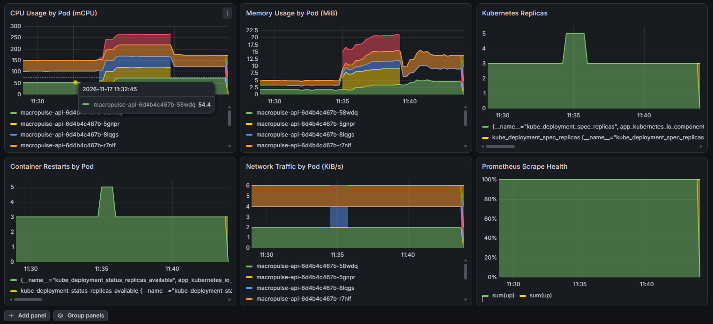
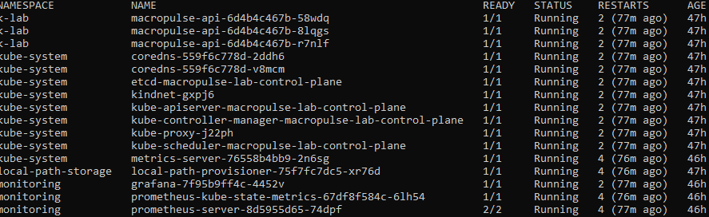

# Local Kubernetes & Observability

This folder documents a **Windows 11 / Docker Desktop / kind environment** used to run and observe MacroPulse AI's FastAPI backend. It is **not** the application's production infrastructure: the public demo uses Cloudflare Workers and Render.

## Architecture and observed deployment

- **Orchestrator:** Kubernetes in Docker (kind), context `kind-macropulse-lab`; Docker container `macropulse-lab-control-plane`.
- **Application namespace:** `k-lab`, deployment `macropulse-api`, with **3 ready replicas** and service `macropulse-api:8000`.
- **Monitoring namespace:** `monitoring`, with Grafana, Prometheus server and kube-state-metrics.
- **Telemetry:** Prometheus scrapes the local cluster; Grafana dashboards can plot container CPU and working-set memory per pod.
- **Access:** temporary `kubectl port-forward` connections bound to local loopback (`127.0.0.1`).

These component names and readiness counts were observed in the local environment on **2026-11-17**. They describe a workstation deployment, not an HA or production-certified deployment.

## Prerequisites

Windows 11, Docker Desktop with a running Linux container engine, PowerShell 5.1+ (7 recommended), Docker CLI, `kubectl`, and the **already-created** kind cluster `macropulse-lab`.

**Scope:** the included startup scripts restart and inspect this existing cluster; they **do not recreate a cluster from an empty machine**. The original installation manifests, exact image build and Helm values have not yet been audited/exported to this repository. Reproducibility of the complete installation requires those reviewed manifests and pinned versions; this folder currently provides reproducible day-to-day operations on the established lab.

## Start and stop (Windows)

Double-click `kubernates_local/Start-KLab.cmd` or, **from the repository root**, run:

~~~powershell
.\kubernates_local\Start-KLab.ps1
~~~

The script starts Docker Desktop if needed, starts the existing kind control-plane container, waits for Kubernetes, checks the API/Grafana/Prometheus deployments and launches loopback-only port forwards in the background. It leaves unrelated processes alone and warns if a local port is occupied. Managed process identifiers and diagnostics are kept **outside Git** in `%LOCALAPPDATA%\MacroPulse-AI\k-lab\`.

| Tool | Local address | Forwarded service |
| --- | --- | --- |
| Grafana | http://127.0.0.1:3000 | `monitoring/grafana:80` |
| FastAPI Swagger | http://127.0.0.1:8000/docs | `k-lab/macropulse-api:8000` |
| Prometheus | http://127.0.0.1:9090 | `monitoring/prometheus-server:80` |

To shut down the managed forwards and the kind node (not Docker Desktop), double-click `Stop-KLab.cmd`, or run from the repository root:

~~~powershell
.\kubernates_local\Stop-KLab.ps1
~~~

These scripts were derived from the locally used startup helpers; because the cluster is on a separate Windows machine, GitHub changes alone do not constitute an end-to-end local execution test.

## Inspect the cluster

Run these commands in PowerShell from any folder:

~~~powershell
kubectl --context kind-macropulse-lab -n k-lab get pods,deployments,services
kubectl --context kind-macropulse-lab -n monitoring get pods,deployments,services
kubectl --context kind-macropulse-lab -n k-lab logs deployment/macropulse-api --tail=50
kubectl --context kind-macropulse-lab -n k-lab rollout status deployment/macropulse-api
~~~

To manually expose the dashboards (keep each `port-forward` terminal open):

~~~powershell
kubectl --context kind-macropulse-lab -n monitoring port-forward service/grafana 3000:80
kubectl --context kind-macropulse-lab -n monitoring port-forward service/prometheus-server 9090:80
kubectl --context kind-macropulse-lab -n k-lab port-forward service/macropulse-api 8000:8000
~~~

To demonstrate **manual** horizontal scaling of the workload:

~~~powershell
kubectl --context kind-macropulse-lab -n k-lab scale deployment/macropulse-api --replicas=5
kubectl --context kind-macropulse-lab -n k-lab rollout status deployment/macropulse-api
kubectl --context kind-macropulse-lab -n k-lab get pods
# Restore the documented baseline:
kubectl --context kind-macropulse-lab -n k-lab scale deployment/macropulse-api --replicas=3
~~~

Manual scaling is not proof of autoscaling, throughput gains or load balancing under traffic. Verify request behavior and metrics separately before making those claims.

## Observe with Grafana / Prometheus

In **Grafana → Explore → Prometheus → Code**, choose **Last 15 minutes** and run:

**Scrape targets (`1` = target responds):**

~~~promql
up
~~~

**FastAPI memory working set by pod (MiB):**

~~~promql
sum by (pod) (
  container_memory_working_set_bytes{
    namespace="k-lab",
    pod=~"macropulse-api-.*",
    container!="",
    container!="POD"
  }
) / 1024 / 1024
~~~

**FastAPI CPU consumption by pod (millicores):**

~~~promql
sum by (pod) (
  rate(container_cpu_usage_seconds_total{
    namespace="k-lab",
    pod=~"macropulse-api-.*",
    container!="",
    container!="POD"
  }[5m])
) * 1000
~~~

**Kubernetes deployment replicas — two queries on the same panel:**

~~~promql
kube_deployment_spec_replicas{namespace="k-lab",deployment="macropulse-api"}
~~~

~~~promql
kube_deployment_status_replicas_available{namespace="k-lab",deployment="macropulse-api"}
~~~

**Container restarts by pod (accumulated count):**

~~~promql
sum by (pod) (
  kube_pod_container_status_restarts_total{namespace="k-lab",pod=~"macropulse-api-.*"}
)
~~~

**Network traffic by pod (KiB/s) — two queries on the same panel:**

~~~promql
sum by (pod) (
  rate(container_network_receive_bytes_total{namespace="k-lab",pod=~"macropulse-api-.*"}[5m])
) / 1024
~~~

~~~promql
sum by (pod) (
  rate(container_network_transmit_bytes_total{namespace="k-lab",pod=~"macropulse-api-.*"}[5m])
) / 1024
~~~

**Scrape health — two instant queries in a Stat panel:**

~~~promql
sum(up)
~~~

~~~promql
count(up)
~~~

The local Grafana dashboard uses **three columns by two rows**, with CPU / Memory / Replicas on the first row and Restarts / Network / Scrape Health on the second. A millicore is CPU use, **not** an HTTP request count. Scrape health describes Prometheus targets, not application HTTP success rates. Some queries (notably network metrics) depend on active scrape targets and may show no data if those metrics are absent.

If a saved Grafana dashboard says **No data**, first confirm its time picker is not pinned to an earlier date, then test `up` in Explore. A restart of non-persistent Prometheus storage may have discarded earlier samples. `up=1` shows an individual scrape target is reachable; it does not by itself prove that every application metric or custom panel query is valid.

## Evidence and screenshots

Two screenshots supplied from the local workstation are now versioned with this documentation. They capture one point in time; they do not prove ongoing production performance or that all metrics are retained across cluster restarts.

**Grafana — six-panel infrastructure dashboard**

**Kubernetes — PowerShell pod/deployment status**

[Capture instructions, privacy checks and limitations](screenshots/README.md). These images come from the author's local setup, not from a simulated dashboard. Avoid including keys, tokens or private machine identifiers in future captures.

## Security and scope

Keep API keys, private environment variables, PostgreSQL connection strings, Kubernetes Secrets, local kubeconfig files and unrestricted `kubectl get ... -o yaml` dumps **out of Git**. Screenshots should show no private credentials or personal paths. Service port forwards intentionally bind to `127.0.0.1` only.

This local setup demonstrates containerized workload operation, replica inspection and CPU/memory observability. It does not assert Kubernetes is used by the public deployment, nor that there is auto-scaling, high availability, production SLO alerting or a complete infrastructure-as-code bootstrap.
