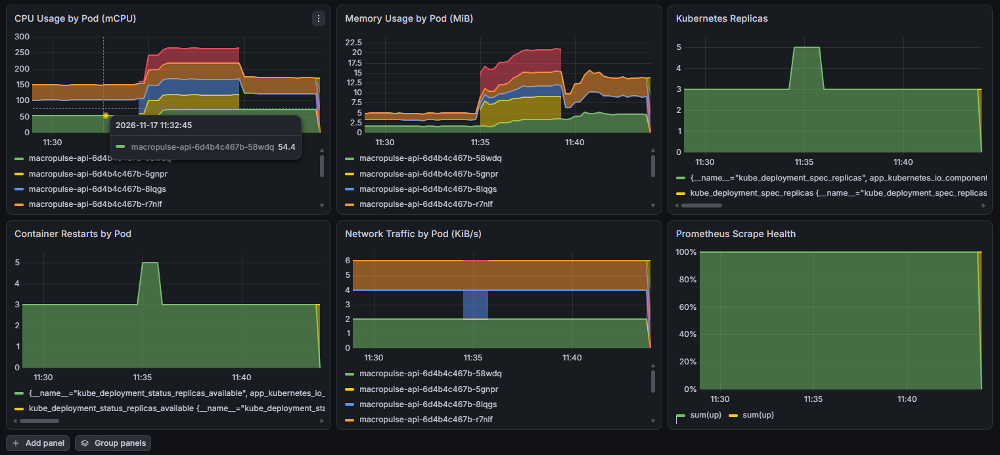
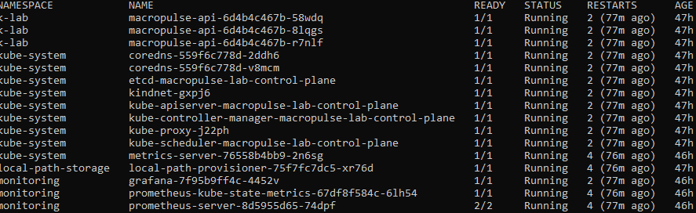

# Local Kubernetes monitoring captures

These two PNG files were supplied from the author's local Windows workstation and are now included directly in this repository:

| Screenshot | Contents |
| --- | --- |
| [grafana-monitoring.png](grafana-monitoring.png) | The Grafana *MacroPulse AI — Infrastructure* dashboard, displaying six infrastructure panels |
| [kubernetes-pods.png](kubernetes-pods.png) | PowerShell / kubectl evidence of the local Kubernetes workloads and monitoring namespace |

## Capture a fresh snapshot

1. Open **Grafana → Dashboards → MacroPulse AI — Infrastructure**, set a relative time range (*Last 15 minutes* or *Last 30 minutes*) and refresh after the cluster has had time to collect metrics. Use kiosk mode and full-screen browser if convenient.
2. Confirm that the charts are displaying actual samples; investigate **No data** in Grafana Explore rather than substituting invented values.
3. For the terminal capture, run the following in PowerShell:

~~~powershell
kubectl --context kind-macropulse-lab -n k-lab get pods,deployments,services
kubectl --context kind-macropulse-lab -n monitoring get pods,deployments,services
~~~

4. Save the resulting images using the same filenames. Inspect captures before pushing for private paths, credentials, connection strings or any unintended information.

These static captures document a single local run. They are **not live service status**, production observability, proof of request latency/throughput, or evidence of autoscaling. The dashboard queries and operational commands are documented in the [parent README](../README.md).
